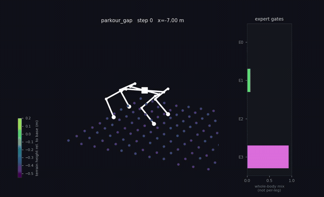
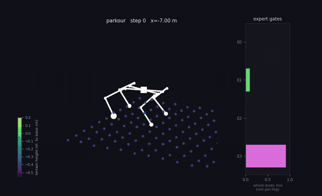
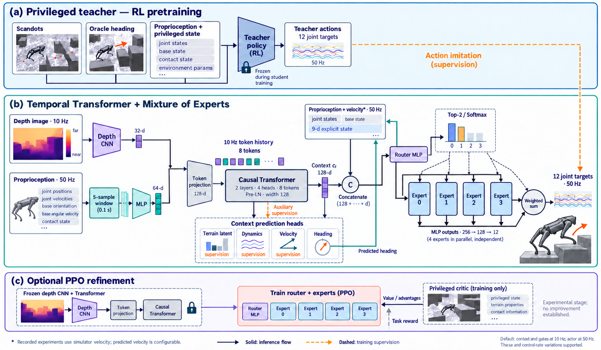

# ExpertParkour

### Temporal Mixture of Experts for Perceptive Quadruped Parkour Locomotion

**A multimodal temporal Transformer and a learned mixture of motor experts for Unitree Go2 parkour in Isaac Lab.**

ExpertParkour extends [Sangbaek Park's Isaaclab_Parkour](https://github.com/CAI23sbP/Isaaclab_Parkour), an Isaac Lab implementation based on [Extreme Parkour with Legged Robots](https://extreme-parkour.github.io/). We replace the student's separate visual and proprioceptive temporal encoders with one causal Transformer, and replace its dense actor with a routed mixture of four expert MLPs. This repository includes training, released weights, recorded rollouts, and tools to inspect attention, routing, dynamics representations, and failures.

[Videos](#policy-in-action) · [Architecture](#architecture) · [Results](#measured-results) · [Reproduce](#reproduce-the-results) · [PPO refinement](#rl-after-distillation) · [Acknowledgements](#acknowledgements)

## Policy in action

These are offline third-person reconstructions from recorded robot link poses and terrain samples, with routing diagnostics, rather than RTX camera recordings.

| Environment 1 | Environment 2 |
| :---: | :---: |
| [](logs/rsl_rl/unitree_go2_parkour_moe/2026-08-12_12-16-19_moe_transformer/playback_it14999/thirdperson_env1.mp4) | [](logs/rsl_rl/unitree_go2_parkour_moe/2026-08-12_12-16-19_moe_transformer/playback_it14999/thirdperson_env2.mp4) |
| **Environment 3** | **Environment 4** |
| [](logs/rsl_rl/unitree_go2_parkour_moe/2026-08-12_12-16-19_moe_transformer/playback_it14999/thirdperson_env3.mp4) | [](logs/rsl_rl/unitree_go2_parkour_moe/2026-08-12_12-16-19_moe_transformer/playback_it14999/thirdperson_env4.mp4) |


## Architecture



*An original illustration inspired by Figure 2 of [Extreme Parkour](https://extreme-parkour.github.io/resources/parkour.pdf), redrawn for this repository's student and training stages. [TMOELoc](docs/assets/architecture-generation.md).*

### What changes from the upstream student?

| Component | Upstream student / GRU baseline | ExpertParkour |
| --- | --- | --- |
| Depth features | Depth CNN | Same CNN and 32-dimensional visual latent |
| Visual memory | GRU | Causal multimodal Transformer |
| Proprioceptive memory | Separate Conv1D history encoder | Five-sample windows fused with depth tokens |
| Representation | Separate visual and dynamics latents | Shared 128-dimensional context `c_t` |
| Motor policy | Dense MLP, copied from the teacher | Four independent expert MLPs and a learned router |
| Routing | — | Top-2 by default; dense soft routing as a separate variant |
| Supervision | Action and heading imitation | Action, heading, terrain, dynamics, velocity, router regularization |

The privileged teacher and environment machinery are inherited from upstream. ExpertParkour changes the **student**, its objectives, and the tools used to evaluate it.

### From observations to actions

1. **Encode inputs.** A normalized `58 × 87` depth image enters the inherited CNN at the 10 Hz perception clock, producing 32 features. An MLP encodes five 53-dimensional proprioceptive samples collected at 50 Hz into 64 features. Concatenation and projection form a 128-dimensional token.
2. **Build context.** Eight tokens enter two Pre-LayerNorm Transformer blocks, each with four attention heads and a 256-dimensional feed-forward layer. Learned positional embeddings and causal masking preserve temporal order. The latest output becomes `c_t ∈ R^128`. The nominal 0.8 s window has 0.7 s between oldest and newest token timestamps.
3. **Predict heading and auxiliary quantities.** Heads predict the teacher's terrain latent, randomized dynamics parameters, the privileged explicit state/velocity block, and two heading components. At inference, predicted heading replaces oracle heading. The terrain-class input is masked; experts receive no assigned skill labels.
4. **Blend experts.** Both router and experts read `u_t = [p_t; c_t; v_t]`, with current proprioception and predicted heading in `p_t`. The router has one 128-unit hidden layer. Each of four experts has hidden widths `[256, 128]` and produces 12 joint-position actions. Top-2 routing keeps the two largest softmax weights and renormalizes them:

   $$a_t = \sum_{i=1}^{4} g_i(u_t)E_i(u_t), \qquad \sum_i g_i(u_t)=1.$$

5. **Separate clocks.** In the released configuration, context and gates refresh at 10 Hz and remain cached between perception steps. Experts run at 50 Hz with fresh proprioception. Episode termination clears temporal buffers and resets gates to uniform mixing until their next refresh.

`FusedExperts` evaluates all four MLPs with batched matrix multiplications before applying gates. **Top-2 is sparse in output weighting; it does not skip expert computation.** Dense routing can use all four outputs without adding expert forward passes.

**Velocity assumption.** The released experiment uses `vel_source="true"`: its 9-dimensional privileged explicit observation block comes from the simulator. Playback and evaluation support `--vel_source predicted`, but changing this input is a separate evaluation condition. The results do not establish fully onboard deployment or sim-to-real transfer.

### Training implementation

The teacher first learns with PPO and privileged observations. Student training freezes it, rolls out the **student's own actions**, queries teacher targets on visited states, and optimizes supervised online distillation. Rewards are discarded at this stage; zero student `Episode_Reward` is expected.

The default objective is:

$$\mathcal L = \mathcal L_{action} + \mathcal L_{yaw} + 5\mathcal L_{terrain} + 5\mathcal L_{dyn} + 5\mathcal L_{vel} + 0.15\mathcal L_{balance} + 10^{-3}\mathcal L_z.$$

Action and heading losses use mean Euclidean residual norms; terrain, dynamics, and velocity use elementwise MSE. Terrain targets come from the teacher's scan encoder. Dynamics targets are standardized mass, center-of-mass offsets, and friction, rather than the released teacher's degenerate privileged latent. Balance loss discourages routing collapse, and z-loss discourages saturated logits. Routing-smoothness regularization is disabled.

The main run uses Gaussian router noise (`σ = 0.3`), 500 warmup iterations followed by cosine learning-rate decay, and teacher action targets and executed student actions clipped to `±4.8`. It trains for 15,000 iterations with 192 environments, 120 control steps per update, and peak student learning rate `1e-3`: about 345.6 million environment steps.

### Implemented variants

Names below replace `<Student>` in `Isaac-Extreme-Parkour-<Student>-Unitree-Go2-v0`; use registered `-Eval-v0`, `-Play-v0`, or `-FT-v0` variants where available.

| Student | Configuration |
| --- | --- |
| `Student` | GRU + Conv1D history encoder + dense actor; baseline |
| `StudentMoE` | Transformer + four experts, top-2 routing; released weights and videos |
| `StudentMoEDense` | Softmax over all four experts, trained dense from the start |
| `StudentMoERisk` | Risk prediction and weighted imitation, reduced auxiliary budget and dynamics targets |
| `StudentMoEWarm` | Risk variant with compatible expert layers initialized from the teacher |
| `StudentMoEDenseWarm` | Dense routing plus compatible-layer warm start |
| `StudentMoEFast` | Dense routing; context at 50 Hz with cached vision and 10 Hz historical tokens; gates stay at 10 Hz |

The control-rate variant is implemented but is **not** the model behind the videos or the top-2 comparison. Registered variants do not imply measured improvements.

## Measured results

Seed 1, 15,000 student-training iterations, the same frozen teacher and environment, and fixed EVAL configurations with **128 environments × 2,000 control steps**. Errors are bootstrap standard errors over environments, not variation over training seeds.

| Policy | Goals / env-minute ↑ | Falls / 1,000 steps ↓ | Courses / env-minute ↑ |
| --- | ---: | ---: | ---: |
| Privileged teacher | 28.54 ± 0.61 | 0.098 ± 0.018 | 3.25 |
| GRU + dense baseline | **27.76 ± 0.56** | **0.168 ± 0.025** | **3.15** |
| Transformer + top-2 MoE | 25.38 ± 0.64 | 0.309 ± 0.033 | 2.58 |

Source: [saved head-to-head statistics](logs/rsl_rl/unitree_go2_parkour_baseline/2026-08-13_19-50-32_gru_dense_baseline/analysis_final/head_to_head.json). The baseline actor starts from teacher weights, while the original MoE actor starts from scratch: a material initialization difference despite equal rollout budgets.

Removing context, flattening gates, or replacing learned attention with uniform attention worsens traversal. Experts specialize predominantly by **gait phase**, rather than one terrain skill each. Applying dense soft routing to top-2-trained weights increased measured pace by `2.77 ± 0.67` goals/env-minute in the intervention sweep; this is distinct from training `StudentMoEDense` from scratch. See [analyses and caveats](CONCLUSIONS.md).

Evaluation includes unfinished trajectories as censored exposure. MXD over terminated episodes alone can favor a policy that falls more often. Read goals, fall hazard, and course completion together, at matched horizons; curriculum difficulty and distillation loss alone are insufficient. All training comparisons are single-seed experiments.

## Reproduce the results

### 1. Environment and installation

Use a CUDA-capable NVIDIA GPU and an installed [Isaac Lab](https://github.com/isaac-sim/IsaacLab) environment. The recorded stack is **Python 3.10, Isaac Sim 4.5.0, Isaac Lab 2.1.0, RSL-RL 2.3.1, and PyTorch 2.7.1+cu128**. Install Isaac Sim / Isaac Lab using their version-specific instructions first; `python` below must resolve to that environment.

```bash
git clone https://github.com/claudiocamolese/ExpertParkour-Temporal-Mixture-of-Experts-for-Perceptive-Quadruped-Parkour-Locomotion.git ExpertParkour
cd ExpertParkour
python -m pip install -e .
python -m pip install -e ./parkour_tasks
python -m pip install rsl-rl-lib==2.3.1 numpy==1.26.4 opencv-python==4.11.0.86 \
    toml matplotlib tqdm wandb tensorboard

# Install FFmpeg with your system package manager for MP4 export.
ffmpeg -version
export CUDA_VISIBLE_DEVICES=0
export PYTHON_BIN="$(command -v python)"
```

The checkout includes weights and rollout archives. Wrappers in [RUNBOOK.md](RUNBOOK.md) source `scripts/launch_env.sh`, which uses the active Python environment and accepts `PYTHON_BIN` and `TEACHER_CKPT` overrides. Optional WSL/CUDA loader paths are added only when present, preserving your existing library paths.

### 2. Run the released student

The inference checkpoint is included; no separate teacher download is needed for playback.

```bash
export MOE_RUN=logs/rsl_rl/unitree_go2_parkour_moe/2026-08-12_12-16-19_moe_transformer
export MOE_CKPT="$MOE_RUN/slim/model_14999.pt"

"$PYTHON_BIN" scripts/rsl_rl/play_student.py \
    --task Isaac-Extreme-Parkour-StudentMoE-Unitree-Go2-Play-v0 \
    --checkpoint "$MOE_CKPT" --num_envs 8 --steps 600 \
    --out_dir outputs/reproduction/playback_it14999 --headless

for env_id in 1 2 3 4 6; do
    "$PYTHON_BIN" scripts/analysis/render_rollout.py \
        outputs/reproduction/playback_it14999/rollout_router.npz \
        --env "$env_id" --stride 2 --elev 18 --azim -62
done
```

Outputs include a depth video with gate overlays, a rollout archive, and third-person views. The offline renderer needs no RTX/Vulkan viewport. To re-render the exact archived trajectories, pass `"$MOE_RUN/playback_it14999/rollout_router.npz"` to the renderer instead. [StudentPolicy](scripts/rsl_rl/modules/student_inference.py) explicitly selects the student, avoiding an upstream inference path that can otherwise select the teacher for an unfamiliar student class.

### 3. Train the teacher and distill both students

Use the [upstream pretrained teacher](https://drive.google.com/file/d/1JtGzwkBixDHUWD_npz2Codc82tsaec_w/view?usp=sharing), used for the reported experiments, or train a new one:

```bash
"$PYTHON_BIN" scripts/rsl_rl/train.py \
    --task Isaac-Extreme-Parkour-Teacher-Unitree-Go2-v0 \
    --seed 1 --max_iterations 50000 --headless
```

Set the downloaded or trained checkpoint path. A new teacher changes the target and need not reproduce recorded numbers exactly.

```bash
export TEACHER_CKPT=/absolute/path/to/model_49999.pt

# Sequential runs with the same teacher and rollout budget.
for student in StudentMoE Student; do
    "$PYTHON_BIN" scripts/rsl_rl/train.py \
        --task "Isaac-Extreme-Parkour-${student}-Unitree-Go2-v0" \
        --teacher_checkpoint "$TEACHER_CKPT" \
        --seed 1 --num_envs 192 --max_iterations 15000 --headless
done
```

Training defaults to Weights & Biases; authenticate with your account, or add `--logger tensorboard`. Checkpoints and configuration snapshots appear in `logs/rsl_rl/<experiment>/<timestamp>_<run_name>/`. Use `StudentMoEDense` to train dense routing from scratch.

### 4. Evaluate at a matched horizon

```bash
"$PYTHON_BIN" scripts/rsl_rl/evaluate_students.py \
    --task Isaac-Extreme-Parkour-StudentMoE-Unitree-Go2-Eval-v0 \
    --checkpoint "$MOE_CKPT" --num_envs 128 --steps 2000 \
    --tag moe --out_dir outputs/reproduction/eval --headless

"$PYTHON_BIN" scripts/rsl_rl/evaluate_students.py \
    --task Isaac-Extreme-Parkour-StudentMoE-Unitree-Go2-Eval-v0 \
    --checkpoint "$TEACHER_CKPT" --policy teacher \
    --num_envs 128 --steps 2000 \
    --tag teacher --out_dir outputs/reproduction/eval --headless

# Baseline weights from step 3 are not bundled here.
export BASE_CKPT=/absolute/path/to/baseline/model_14999.pt
"$PYTHON_BIN" scripts/rsl_rl/evaluate_students.py \
    --task Isaac-Extreme-Parkour-Student-Unitree-Go2-Eval-v0 \
    --checkpoint "$BASE_CKPT" --num_envs 128 --steps 2000 \
    --tag baseline --out_dir outputs/reproduction/eval --headless

"$PYTHON_BIN" scripts/analysis/episode_metrics.py \
    outputs/reproduction/eval/trace_moe.npz \
    outputs/reproduction/eval/trace_teacher.npz \
    outputs/reproduction/eval/trace_baseline.npz \
    --horizon 2000 --per-terrain --boot 2000 \
    --out outputs/reproduction/eval/head_to_head.json
```

Recompute the reported comparison **without Isaac Sim**, using committed traces:

```bash
"$PYTHON_BIN" scripts/analysis/episode_metrics.py \
    "$MOE_RUN/analysis_final/trace_main.npz" \
    "$MOE_RUN/analysis_final/trace_teacher.npz" \
    logs/rsl_rl/unitree_go2_parkour_baseline/2026-08-13_19-50-32_gru_dense_baseline/analysis_final/trace_baseline.npz \
    --horizon 2000 --per-terrain --boot 2000
```

### 5. Inspect what the model learned

```bash
"$PYTHON_BIN" scripts/analysis/analyze_student.py "$MOE_RUN/analysis_final/trace_main.npz"
"$PYTHON_BIN" scripts/analysis/attention_probe.py "$MOE_RUN/analysis_final/trace_main.npz"
"$PYTHON_BIN" scripts/analysis/inspect_moe_weights.py "$MOE_CKPT"
```

Attention analysis needs a trace recorded with `evaluate_students.py --attention`. See [RUNBOOK.md](RUNBOOK.md) for recording, probes, and interventions. Dynamics probes use the **training task**, where physical randomization remains active, and split by environment to avoid target leakage.

## RL after distillation

Distillation optimizes agreement with teacher actions; the remaining gap is concentrated in rare, costly falls. We implemented a third stage in [finetune_rl.py](scripts/rsl_rl/finetune_rl.py): **PPO on the task reward**, starting from a distilled student.

By default, refinement freezes the depth CNN and Transformer, trains router and experts, and learns a Gaussian action standard deviation. An asymmetric critic reads privileged observations, starts from teacher critic weights when shapes match, and receives 300 warmup iterations before actor updates. PPO uses GAE, a clipped surrogate, separate actor/critic optimizers and gradient clipping, and KL-adaptive learning rate. Router noise is disabled. Replay stores the inputs that produced cached gates and excludes post-reset samples whose gates cannot be reproduced. Timeout bootstrap credit stays separate from logged environment reward.

**Observed outcome: refinement degraded traversal.** The [recorded diagnostic sequence](CONCLUSIONS.md#the-rl-fine-tuning-stage-tried-and-it-does-not-work-here) reports:

| Stage | Goals / env-minute ↑ | Falls / 1,000 steps ↓ | Courses / env-minute ↑ |
| --- | ---: | ---: | ---: |
| Before refinement | 24.25 | 0.34 | 1.78 |
| After 200 policy updates | 14.03 | 1.08 | 0.16 |
| After 2,200 policy updates | 10.94 | 1.49 | 0.03 |

This is a separate refinement diagnostic, not part of the fixed-EVAL comparison above. The inherited reward penalizes contacts, action changes, and joint accelerations; observed behavior is consistent with an objective that favors reducing motion at the expense of course completion. That is the working diagnosis, rather than proof that PPO cannot refine parkour policies. The videos and recommended playback weights remain the **distilled policy**.

Reproduce the refinement procedure with:

```bash
"$PYTHON_BIN" scripts/rsl_rl/finetune_rl.py \
    --task Isaac-Extreme-Parkour-StudentMoE-Unitree-Go2-FT-v0 \
    --checkpoint "$MOE_CKPT" --num_envs 192 --max_iterations 20000 \
    --steps_per_env 24 --epochs 2 --minibatches 4 \
    --init_noise_std 0.25 --critic_warmup 300 \
    --run_name top2_ft --headless
```

This is the configured budget, not a claim that the degraded diagnostic completed 20,000 iterations. With `σ = 0.25`, the derived KL target is `0.08`. Dense refinement uses a `StudentMoEDense` checkpoint, task `Isaac-Extreme-Parkour-StudentMoEDense-Unitree-Go2-FT-v0`, and `--top_k 4`. The current refinement loop is implemented for the MoE path; a registered GRU `-FT-` task alone does not make that loop compatible with the baseline.

## Code map and artifacts

| Path | Responsibility |
| --- | --- |
| [temporal_transformer.py](scripts/rsl_rl/modules/feature_extractors/temporal_transformer.py) | Tokenization, buffers, causal attention, prediction heads |
| [moe_actor.py](scripts/rsl_rl/modules/moe_actor.py) | Fused experts, top-k/dense routing, regularizers |
| [distillation_moe.py](scripts/rsl_rl/modules/distillation_moe.py) | Student initialization, losses, optimization |
| [on_policy_runner_moe.py](scripts/rsl_rl/modules/on_policy_runner_moe.py) | Rollouts, teacher queries, heading replacement, checkpoints |
| [student_inference.py](scripts/rsl_rl/modules/student_inference.py) | Teacher/student inference and interventions |
| [ppo_utils.py](scripts/rsl_rl/modules/ppo_utils.py) | Simulator-independent critic, trajectory returns, and replay reshaping |
| [rsl_student_moe_cfg.py](parkour_tasks/parkour_tasks/extreme_parkour_task/config/go2/agents/rsl_student_moe_cfg.py) | Student variants and run settings |
| [parkour_rl_cfg.py](parkour_tasks/parkour_tasks/extreme_parkour_task/config/go2/agents/parkour_rl_cfg.py) | Architecture dimensions, routing, loss coefficients |
| [scripts/analysis/](scripts/analysis/) | Metrics, attention, routing, probes, rendering |
| [RUNBOOK.md](RUNBOOK.md) | Operational commands and workstation notes |
| [Development guide](docs/DEVELOPMENT.md) | Ownership boundary, code conventions, and CPU regression checks |

Released `slim/*.pt` checkpoints retain inference weights and omit optimizer state. They support playback, evaluation, and fresh optimization, but cannot restore the original Adam trajectory. Export newly trained student weights with:

```bash
"$PYTHON_BIN" scripts/export_slim_checkpoint.py /path/to/model_14999.pt
```

## Acknowledgements

This project builds directly on **[Isaaclab_Parkour](https://github.com/CAI23sbP/Isaaclab_Parkour) by Sangbaek Park ([CAI23sbP](https://github.com/CAI23sbP)) and its contributors**. We thank them for releasing the Isaac Lab parkour environments, teacher–student implementation, robot/task configurations, and pretrained policies that made this extension possible. Their work remains the foundation of this repository.

We acknowledge **Xuxin Cheng, Kexin Shi, Ananye Agarwal, and Deepak Pathak**, authors of [Extreme Parkour with Legged Robots](https://extreme-parkour.github.io/), for the original learning framework and open-source implementation. Figure 2 inspired the teacher–student layout of our newly generated illustration.

Thanks to the **Isaac Lab / Isaac Sim**, **RSL-RL**, and **PyTorch** developers for the simulation and learning infrastructure. ExpertParkour's contributions are the modified student architecture, training variants, refinement experiments, and analysis tooling described above; credit for the inherited framework belongs to its authors.

## Citation and license

Please acknowledge the upstream repository and cite the underlying work when using this code in research. This repository retains its [GPL-3.0 license](LICENSE); source-file notices and third-party licenses remain applicable.

```bibtex
@misc{park2025isaaclabparkour,
  author       = {Park, Sangbaek},
  title        = {Isaaclab\_Parkour},
  year         = {2025},
  howpublished = {\url{https://github.com/CAI23sbP/Isaaclab_Parkour}}
}

@article{cheng2023parkour,
  title   = {Extreme Parkour with Legged Robots},
  author  = {Cheng, Xuxin and Shi, Kexin and Agarwal, Ananye and Pathak, Deepak},
  journal = {arXiv preprint arXiv:2309.14341},
  year    = {2023}
}

@article{mittal2023orbit,
  author  = {Mittal, Mayank and Yu, Calvin and Yu, Qinxi and Liu, Jingzhou and
             Rudin, Nikita and Hoeller, David and Yuan, Jia Lin and Singh, Ritvik and
             Guo, Yunrong and Mazhar, Hammad and Mandlekar, Ajay and Babich, Buck and
             State, Gavriel and Hutter, Marco and Garg, Animesh},
  title   = {Orbit: A Unified Simulation Framework for Interactive Robot Learning Environments},
  journal = {IEEE Robotics and Automation Letters},
  year    = {2023},
  volume  = {8},
  number  = {6},
  pages   = {3740--3747},
  doi     = {10.1109/LRA.2023.3270034}
}
```
